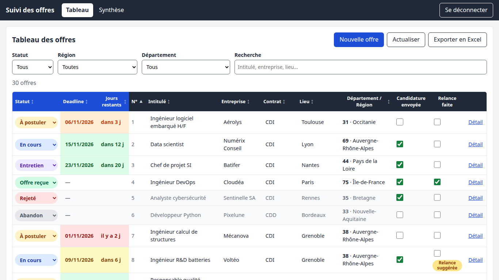
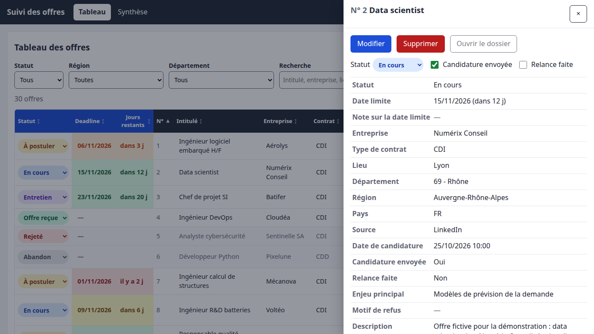
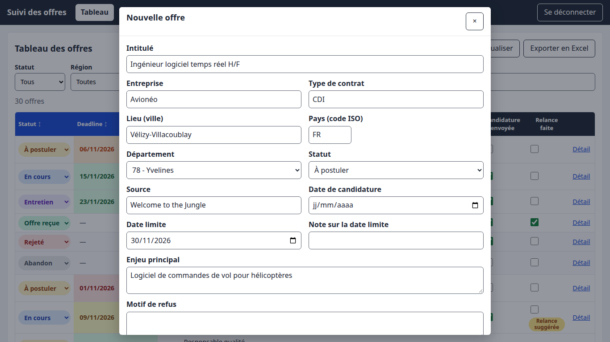
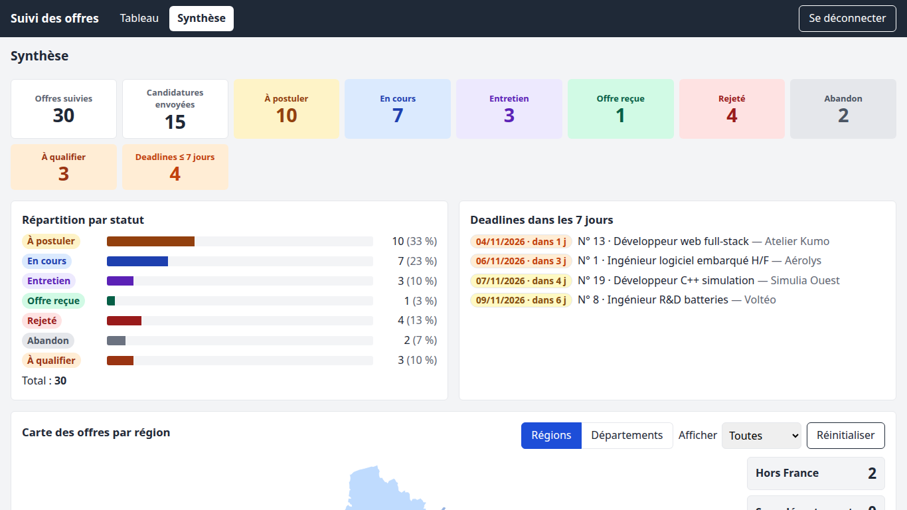
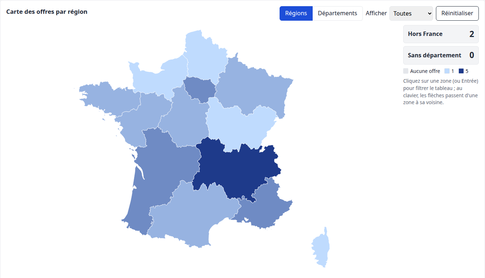
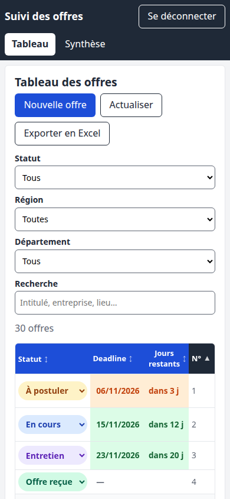

# Suivi de recherche d'emploi (jobs-tracker)

Un petit service auto-hébergé qui remplace le classeur Excel de suivi des candidatures : une base
SQLite comme source de vérité, une interface web claire, un CLI, et l'Excel régénéré à la demande.



*Captures réalisées avec des données fictives (entreprises et offres inventées).*

## Fonctionnalités

- **Tableau des offres** : statut et deadline visibles ensemble, en tête de ligne, avec les jours
  restants ; couleurs de statut et d'urgence reprises de l'Excel, lignes Rejeté / Abandon
  estompées, badge « Relance suggérée » ; filtres (statut, région, département, texte), tri par
  colonne et édition en ligne.
- **Panneau de détail et formulaire** : tous les champs d'une offre, modification complète,
  suppression avec confirmation ; formulaire « Nouvelle offre » avec menus déroulants, cases à
  cocher et erreurs affichées à côté des champs.
- **Synthèse et carte de France interactive** : compteurs, répartition par statut, carte par
  régions ou par départements (filtre de statut) ; un clic sur une zone ouvre le tableau filtré.
- **Import / export Excel** : export fidèle à la v2 (17 colonnes, menus déroulants, couleurs,
  onglet Synthèse) depuis l'interface, l'API ou le CLI ; import du classeur d'origine (ou v2) en
  ligne de commande sur le serveur (`python -m backend.app.import_xlsx`, voir
  [Importer le classeur Excel d'origine](#importer-le-classeur-excel-dorigine)).
- **CLI** (`cli/jobs.py`, Python standard, Windows et Linux) : ajouter, modifier, lister, exporter
  les offres.
- **Dossier Nextcloud par offre** (facultatif, WebDAV) : chaque offre retrouve son dossier de
  candidature par son numéro ; « Ouvrir le dossier », liste des fichiers et création du dossier
  (avec `CV/` et `Lettre/`) depuis le panneau de détail ou le CLI.
- **Sauvegardes quotidiennes** de la base dans `DATA_DIR/backups/` (14 jours conservés par
  défaut), à compléter par des snapshots ZFS.
- **API REST** protégée par un jeton (`/api/...`, documentation interactive sur `/docs`).

## Captures



Le panneau de détail : tous les champs de l'offre, modifiables, et le bouton « Ouvrir le
dossier », grisé ici car le lien Nextcloud est désactivé dans cette démo.



Le formulaire de saisie : menus déroulants pour le statut et le département (la région en est
déduite) ; plus bas dans le formulaire, hors de la capture, des suggestions pour le type de
contrat et des cases à cocher pour la candidature et la relance.



La Synthèse : compteurs, répartition par statut et deadlines dans les 7 jours.



La carte interactive : régions ou départements, filtre de statut, offres hors France et sans
département ; un clic (ou Entrée au clavier) ouvre le tableau filtré sur la zone.



Sur téléphone, le tableau défile horizontalement et la colonne Statut reste visible.

## Pile technique

- Backend : Python 3.12, FastAPI, SQLite en mode WAL, migrations SQL versionnées.
- Interface : React, Vite et TypeScript, compilée et servie en statique par le backend.
- Excel : openpyxl (import et export v2).
- Déploiement : une seule image Docker (`linux/amd64`, non root), Docker Compose en local,
  app « Install via YAML » sur TrueNAS SCALE.

Aucun secret n'est versionné : les valeurs se mettent dans `.env` (copie de `.env.example`,
ignoré par git) ou dans la configuration de l'app TrueNAS.

## Sommaire

- [Variables d'environnement du service](#variables-denvironnement-du-service)
- [Développement local](#développement-local)
- [Interface web](#interface-web)
- [CLI (`cli/jobs.py`)](#cli-clijobspy)
- [Dossiers Nextcloud (WebDAV)](#dossiers-nextcloud-webdav)
- [Fonds de carte](#fonds-de-carte)
- [Construire et publier l'image sur GHCR](#construire-et-publier-limage-sur-ghcr)
- [Déploiement sur TrueNAS SCALE](#déploiement-sur-truenas-scale)
- [Sauvegardes et restauration](#sauvegardes-et-restauration)

## Variables d'environnement du service

| Variable           | Défaut          | Rôle                                                          |
|--------------------|-----------------|---------------------------------------------------------------|
| `API_TOKEN`        | (aucun)         | Jeton Bearer obligatoire ; le service refuse de démarrer sans |
| `DATA_DIR`         | `/data`         | Base `jobs.db` et sauvegardes `backups/`                      |
| `FOLLOW_UP_DAYS`   | `14`            | Jours sans réponse avant de suggérer une relance              |
| `BACKUP_KEEP_DAYS` | `14`            | Jours de sauvegardes quotidiennes conservés                   |
| `NEXTCLOUD_WEBDAV` | `false`         | `true` : lien avec les dossiers Nextcloud par WebDAV          |
| `NEXTCLOUD_URL`    | (vide)          | Adresse de Nextcloud, ex. `http://nextcloud.local:8080`       |
| `NEXTCLOUD_USER`   | (vide)          | Identifiant Nextcloud propriétaire des dossiers               |
| `NEXTCLOUD_APP_PASSWORD` | (vide)    | Mot de passe d'application Nextcloud (secret, jamais versionné) |
| `NEXTCLOUD_ROOT`   | `/Candidatures` | Dossier racine des candidatures dans Nextcloud |
| `TZ`               | UTC             | Fuseau horaire (date des sauvegardes), ex. `Europe/Paris`     |

Générer un jeton : `openssl rand -hex 32` (Linux) ou
`[Convert]::ToHexString([Security.Cryptography.RandomNumberGenerator]::GetBytes(32))` (PowerShell 7).

## Développement local

Prérequis : Python 3.12, Docker (facultatif pour le dev, nécessaire pour l'image).

```bash
python3.12 -m venv .venv
.venv/bin/pip install -e ".[dev]"
cp .env.example .env                 # puis renseigner API_TOKEN

.venv/bin/pytest -q backend/tests    # tests
.venv/bin/ruff check backend cli     # lint
```

### Lancer le service

Sans Docker (données dans `var/`, ignoré par git) :

```bash
API_TOKEN=dev-local DATA_DIR=var .venv/bin/uvicorn backend.app.main:app_from_env --factory --reload --port 8000
```

Avec Docker Compose (`compose.yml`, données dans `./var`) :

```bash
cp .env.example .env                           # puis renseigner API_TOKEN
mkdir -p var                                   # à créer avec votre compte, avant le premier up
docker compose up -d --build
curl http://localhost:8000/api/health          # {"status":"ok"}
docker compose logs -f jobs
docker compose down
```

Le conteneur de dev tourne avec l'UID/GID 1000 pour pouvoir écrire dans `./var` ; si votre
compte a un autre UID : `export LOCAL_UID=$(id -u) LOCAL_GID=$(id -g)` avant `docker compose up`.
`./var` doit exister et appartenir à votre compte : `compose.yml` interdit à Docker de le créer
(il le créerait au nom de root et le conteneur ne pourrait pas ouvrir la base). Sans `mkdir -p var`,
`docker compose up` s'arrête sur une erreur de montage (chemin inexistant) ; si `var/` a déjà été
créé par root : `sudo chown -R $(id -u):$(id -g) var`.
Le dossier `data/` du dépôt contient le référentiel des départements (embarqué dans l'image) : il
ne sert pas de volume de données.

### Importer le classeur Excel d'origine

L'import accepte le format d'origine ou la v2. Tout le fichier est validé avant écriture, en une
seule transaction. Sans `--replace`, il échoue si un numéro d'offre existe déjà ; avec `--replace`,
la base est d'abord copiée dans `backups/before-import-<horodatage>.db`, puis toutes les offres
sont remplacées.

Dans le conteneur de dev (le fichier doit être visible du conteneur, par exemple dans `./var`,
monté sur `/data`) :

```bash
cp "Offres de contrats.xlsx" var/suivi.xlsx
docker compose exec jobs python -m backend.app.import_xlsx /data/suivi.xlsx
docker compose exec jobs python -m backend.app.import_xlsx /data/suivi.xlsx --replace
```

Sans Docker :

```bash
DATA_DIR=var .venv/bin/python -m backend.app.import_xlsx "Offres de contrats.xlsx"
```

Sur TrueNAS, copier le fichier dans le dataset (`/mnt/<pool>/apps/jobs-tracker/`), puis ouvrir un
shell dans le conteneur (Apps > jobs > Shell) et lancer
`python -m backend.app.import_xlsx /data/suivi.xlsx`.

## Interface web

L'interface React est servie par le même conteneur, à la racine du service
(`http://localhost:8000/` en local, l'adresse de l'app sur TrueNAS) ; l'API reste sous `/api`.

**Première connexion.** L'écran d'accueil demande le jeton d'accès (`API_TOKEN` du service). Il
est vérifié par un appel à l'API puis mémorisé dans le navigateur (`localStorage`, clé
`jobs-tracker.api-token`) : les visites suivantes ouvrent directement le tableau. « Se
déconnecter » l'efface ; si le service refuse le jeton mémorisé (jeton changé), l'écran du jeton
revient avec un message. Le jeton n'est jamais placé dans l'URL.

**Fonctions.**

- Tableau des offres : Statut, Deadline et Jours restants en premier, couleurs de statut et
  d'urgence de l'Excel, lignes Rejeté / Abandon estompées ; filtres rapides (statut, région,
  département, texte) ; tri par colonne ; édition en ligne des champs simples (Entrée enregistre,
  Échap annule ; en cas de refus du service, la valeur revient et un message s'affiche) ; badge
  « Relance suggérée » ; bouton « Exporter en Excel » (même fichier que `GET /api/export.xlsx`).
- « Nouvelle offre » : formulaire avec menus déroulants et cases à cocher, erreurs à côté des
  champs ; une saisie en cours n'est abandonnée qu'après confirmation.
- Panneau de détail (bouton « Détail » d'une ligne) : tous les champs, modification complète,
  suppression avec confirmation.
- Dossier Nextcloud (lien WebDAV activé, voir « Dossiers Nextcloud (WebDAV) » plus bas) : à
  l'ouverture du panneau, le dossier de l'offre est cherché par son numéro ; « Ouvrir le dossier »
  l'ouvre alors dans un nouvel onglet (un vrai lien, jamais bloqué comme fenêtre surgissante) et
  la section « Dossier Nextcloud » liste son contenu (sous-dossiers d'abord ; nom, taille, date de
  modification à l'heure locale), chaque nom ouvrant l'élément dans Nextcloud (`openfile=true`
  pour un fichier). Sans dossier, « Créer le dossier » le crée (`NN - <intitulé> <entreprise>`,
  avec `CV/` et `Lettre/`) ; deux dossiers au même numéro, Nextcloud injoignable ou accès refusé
  donnent un message clair avec « Réessayer ». Le message « Offre n° N créée. » dit aussi si son
  dossier a été créé, retrouvé ou non créé (avec le motif). Lien non activé :
  « Ouvrir le dossier » reste désactivé, son infobulle en donne la raison (`NEXTCLOUD_WEBDAV`
  absent ou réglage invalide).
- Synthèse : compteurs, répartition par statut et carte de France (régions ou départements, filtre
  de statut) ; un clic sur une zone, ou sur « Hors France » / « Sans département », ouvre le
  tableau filtré. Un tableau des comptes sert d'alternative texte à la carte.
- Mobile et clavier : sur un écran étroit, le tableau défile horizontalement (la colonne Statut
  reste visible) ; lien « Aller au contenu principal » au premier Tab, focus visible, la carte
  n'est qu'un arrêt de tabulation (les flèches passent d'une zone à sa voisine, Entrée filtre).

**Développement.** Prérequis : Node.js 22 et npm. Lancer le backend sur le port 8000, puis le
serveur Vite, qui relaie `/api` vers `http://localhost:8000` (`frontend/vite.config.ts`) :

```bash
API_TOKEN=dev-local DATA_DIR=var .venv/bin/uvicorn backend.app.main:app_from_env --factory --reload --port 8000
npm --prefix frontend ci
npm --prefix frontend run dev            # http://localhost:5173, jeton : dev-local
```

Vérifications du front : `npm --prefix frontend run lint`, `run typecheck`, `test` (depuis le
dépôt complet : un test compare le référentiel embarqué à `data/departements.json`) et
`run build`.

**Dans l'image.** Le `Dockerfile` compile le front dans une étape Node (`npm ci` puis
`npm run build`) et copie `frontend/dist` dans `backend/app/static`, que FastAPI sert en
statique ; il n'y a rien à installer ni à lancer à part. Pour servir un autre dossier compilé :
variable `FRONTEND_DIR`.

## CLI (`cli/jobs.py`)

Le CLI n'utilise que la bibliothèque standard (Python 3.10 ou plus) : il suffit de copier
`cli/jobs.py` sur le poste, sans installation de dépendance. Il lit deux variables :

- `JOBS_API_URL` : adresse du service (défaut `http://localhost:8000`), par exemple
  `http://truenas.local:8000` ;
- `JOBS_API_TOKEN` : la même valeur que `API_TOKEN` côté service.

Linux (ajouter à `~/.bashrc` ou `~/.profile`, puis rouvrir le terminal) :

```bash
export JOBS_API_URL="http://truenas.local:8000"
export JOBS_API_TOKEN="<votre jeton>"
```

Windows (PowerShell ; `setx` enregistre la variable pour les prochaines sessions, rouvrir le
terminal ensuite) :

```powershell
setx JOBS_API_URL "http://truenas.local:8000"
setx JOBS_API_TOKEN "<votre jeton>"
```

Exemples :

```bash
python cli/jobs.py meta                                   # statuts, régions, départements
python cli/jobs.py add --title "Ingénieur données" --company ACME --location "Vélizy-Villacoublay" \
    --department 78 --status "À postuler" --deadline 2026-11-30 --link https://exemple.fr/offre
python cli/jobs.py update 17 --status "Rejeté" --rejection-reason "Profil plus senior recherché"
python cli/jobs.py list --status "En cours" --region "Île-de-France"
python cli/jobs.py --json list --department 2A
python cli/jobs.py delete 17 --yes                        # --yes obligatoire
python cli/jobs.py export -o suivi.xlsx --force           # --force pour écraser un fichier existant
python cli/jobs.py folder 17                              # dossier Nextcloud : lien et fichiers
python cli/jobs.py folder 17 --create                     # crée le dossier s'il n'existe pas
```

`python cli/jobs.py --help` et `python cli/jobs.py <commande> --help` détaillent toutes les
options. Sous PowerShell, pour rediriger la sortie vers un fichier ou un tube en UTF-8 :
`$OutputEncoding = [Console]::OutputEncoding = [Text.Encoding]::UTF8`, ou `Out-File -Encoding utf8`.

## Dossiers Nextcloud (WebDAV)

Chaque offre peut être reliée à son dossier de candidature dans Nextcloud. Les dossiers gardent
leur nom actuel, « NN - <intitulé> <entreprise> » (ex. « 01 - Chargé de mission
Acme ») sous `NEXTCLOUD_ROOT` : le service retrouve le dossier d'une offre par le numéro en tête
de son nom (« 1 », « 01 » ou « 0001 » ; l'offre 1 ne correspond jamais à « 10 - … »). Il ne fait
que lire et créer des dossiers par WebDAV : il ne renomme, ne déplace, ne modifie ni ne supprime
jamais rien, et n'écrit jamais dans le répertoire de données de Nextcloud.

Désactivé par défaut. Pour l'activer, renseigner dans `.env` (ou dans l'app TrueNAS) :

```bash
NEXTCLOUD_WEBDAV=true
NEXTCLOUD_URL=http://nextcloud.local:8080      # adresse de votre Nextcloud, sans chemin
NEXTCLOUD_USER=<identifiant Nextcloud>
NEXTCLOUD_APP_PASSWORD=<mot de passe d'application>
NEXTCLOUD_ROOT=/Candidatures                   # dossier qui contient les dossiers des offres
```

Créer le mot de passe d'application : dans Nextcloud, menu du compte > Paramètres personnels >
Sécurité > « Appareils et sessions », saisir un nom (ex. `jobs-tracker`) puis « Créer un nouveau
mot de passe d'application » ; copier le mot de passe affiché (il ne sera plus montré) dans
`NEXTCLOUD_APP_PASSWORD`. Ne jamais utiliser le mot de passe principal du compte ; pour couper
l'accès, révoquer ce mot de passe dans le même écran. `NEXTCLOUD_USER` est l'identifiant de
connexion (celui des liens WebDAV, Paramètres > Fichiers > WebDAV : `.../remote.php/dav/files/<identifiant>/`).

Ce que fait le service une fois activé :

- `POST /api/offers` crée l'offre, puis son dossier (avec `CV/` et `Lettre/`) ; si un dossier
  portant déjà ce numéro existe, il est réutilisé (jamais renommé) ; seuls `CV/` ou `Lettre/`
  manquants y sont ajoutés, rien d'existant n'est modifié. À la création d'une offre, chaque
  requête WebDAV attend au plus 5 s (10 s pour les routes `/folder`). L'offre est enregistrée même si
  Nextcloud est injoignable : le champ `folder` de la réponse indique `created`, `existing`,
  `error` (avec le motif) ou `disabled`, et l'échec est écrit dans le journal (sans identifiants).
- `GET /api/offers/{id}/folder` renvoie le nom du dossier, son lien dans l'interface web
  (`<NEXTCLOUD_URL>/apps/files/files/<id>?dir=<racine>/<dossier>`) et ses fichiers ;
  `POST /api/offers/{id}/folder` le crée s'il manque (201, ou 200 s'il existait). Erreurs en
  français avec un code : 404 (`offer_not_found`, `folder_not_found`), 409 (`folder_ambiguous` :
  deux dossiers portent le même numéro, à corriger dans Nextcloud), 503 (`nextcloud_disabled`,
  `nextcloud_config`, `nextcloud_unreachable`), 502 (`nextcloud_auth`, `nextcloud_root_missing`,
  `nextcloud_error`).
- `GET /api/meta` indique `nextcloud_enabled` et, si la configuration est invalide ou incomplète,
  `nextcloud_error`. Une configuration fautive n'empêche ni le démarrage ni la création d'offres.
- CLI : `jobs.py folder <id>` (lien et fichiers), `--create` pour créer le dossier ; `jobs.py show`
  ajoute la ligne « Dossier Nextcloud » quand le lien est actif.

Réseau local en HTTP : avec une adresse `http://` (sans TLS), le mot de passe d'application
circule en clair (authentification Basic) entre le service et Nextcloud. C'est acceptable sur le
réseau local de la maison, pas au travers d'Internet : utiliser alors `https://`. Si le service ne
joint pas Nextcloud (même machine TrueNAS, autre app), utiliser l'adresse IP du NAS et le port de
l'app Nextcloud, pas `localhost` (qui désigne le conteneur lui-même).

## Fonds de carte

La carte de l'interface utilise les contours des régions et départements métropolitains de
[gregoiredavid/france-geojson](https://github.com/gregoiredavid/france-geojson), version
« simplifiée », figée au commit `5d34ee6d0140c29f785fdb047d9329f1aab58833` (2018-10-16) :
codes et noms INSEE (COG 2018), contours IGN Admin Express COG 2018. Le dépôt n'a pas de
fichier LICENSE ; son README renvoie aux conditions d'Admin Express, publiées sous Licence
Ouverte Etalab, qui autorise la réutilisation à condition de citer la source (ce paragraphe).
Seul le fichier des départements est téléchargé ; il est converti en un TopoJSON allégé
(`frontend/src/geo/data/france.topo.json`, ~53 kB, propriétés `code` et `nom` seules) qui
contient les départements et les 13 régions, obtenues par fusion des départements selon
`data/departements.json` (frontières communes, noms de régions du référentiel). Il est embarqué
dans l'appli (aucun appel externe) et régénérable par `npm --prefix frontend run build:geo`
(URL et empreinte SHA-256 figées dans `frontend/scripts/build-geo.mjs`).

## Construire et publier l'image sur GHCR

L'image cible `linux/amd64` (TrueNAS). Elle est construite en deux étapes (dépendances dans un
venv, puis image finale non root, UID/GID 568) et contient un `HEALTHCHECK` sur `/api/health`.

1. Créer sur GitHub un jeton d'accès personnel (PAT « classic ») avec le droit `write:packages`
   (et `read:packages`). Ne pas l'enregistrer dans le dépôt.
2. Se connecter au registre (coller le jeton à l'invite : il n'apparaît pas dans l'historique) :

   ```bash
   docker login ghcr.io -u <utilisateur>
   # mot de passe : coller le PAT
   ```

3. Construire et pousser :

   ```bash
   docker buildx build --platform linux/amd64 \
     -t ghcr.io/<utilisateur>/jobs-tracker:latest \
     -t ghcr.io/<utilisateur>/jobs-tracker:$(date +%Y%m%d) \
     --push .
   ```

Le paquet créé sur GHCR est privé par défaut : le laisser privé.

## Déploiement sur TrueNAS SCALE

Deux façons d'amener l'image sur le NAS : par le registre GHCR (sections ci-dessous), ou sans
registre, en copiant une image construite sur le PC (voir « Variante sans registre : image
locale » plus bas). La préparation du dataset suit le même principe (propriétaire `apps`,
568:568), avec un chemin et un préréglage propres à la variante.

### Préparer le dataset

1. Créer un dataset, par exemple `<pool>/apps/jobs-tracker` (monté sur `/mnt/<pool>/apps/jobs-tracker`).
2. Lui donner pour propriétaire l'utilisateur et le groupe `apps` (UID/GID 568), avec
   lecture/écriture : Datasets > Permissions, ou en shell `chown -R 568:568 /mnt/<pool>/apps/jobs-tracker`.

### Connecter TrueNAS au registre privé

Créer un second PAT avec seulement `read:packages` (lecture seule, dédié au NAS), puis :

- TrueNAS 24.10 et plus récent : Apps > Configuration > Manage Container Images / Docker
  Registries > Add : URI `https://ghcr.io`, utilisateur `<utilisateur>`, mot de passe = le PAT.
- À défaut d'écran de registre, en shell sur le NAS : `sudo docker login ghcr.io -u <utilisateur>`
  (coller le PAT à l'invite).

### Installer l'app

Apps > Discover Apps > menu ⋮ > Install via YAML, coller le contenu de `compose.truenas.yml`
après avoir remplacé `<utilisateur>` et `<pool>`, et renseigné `API_TOKEN` (vide dans le fichier ;
jeton long et aléatoire, par exemple `openssl rand -hex 32`, jamais versionné). Tant que
`API_TOKEN` est vide, le service refuse de démarrer. Vérifier ensuite :

```bash
curl http://<nas>:8000/api/health        # {"status":"ok"}
```

L'état de santé s'affiche aussi dans l'écran de l'app (healthcheck toutes les 30 s).

### Mettre à jour

1. Construire et pousser une nouvelle image (section GHCR ci-dessus).
2. Prendre un snapshot du dataset (voir plus bas) avant toute mise à jour.
3. Sur TrueNAS : Apps > jobs > Update (ou Edit puis Save) : avec `pull_policy: always`, l'image
   `latest` est retéléchargée et le conteneur recréé. Les migrations de la base s'appliquent
   automatiquement au démarrage.
4. Vérifier `/api/health` et les logs de l'app.

Pour revenir en arrière, remplacer `latest` par l'étiquette datée précédente dans le YAML, et
restaurer le snapshot si la base a été migrée entre-temps.

### Variante sans registre : image locale

Sans compte GitHub ni registre, l'image construite sur le PC est copiée sur le NAS puis chargée
dans son Docker. Les noms ci-dessous sont des exemples : pool `tank`, dataset `tank/apps/jobs-tracker`,
image `jobs-tracker:latest`, app `jobs`.

1. Sur le PC, construire l'image et l'exporter en archive :

   ```bash
   docker build --platform linux/amd64 -t jobs-tracker:latest .
   docker save jobs-tracker:latest | gzip > jobs-tracker.tar.gz
   scp jobs-tracker.tar.gz <admin>@<nas>:/tmp/
   ```

2. Sur le NAS, dans un shell root (System > Shell, ou `ssh` puis `sudo -i`), charger l'image :
   `docker load -i /tmp/jobs-tracker.tar.gz`, puis supprimer l'archive. Un `sudo docker load`
   lancé à travers un tube `ssh` échoue (pas de terminal pour le mot de passe) : copier d'abord,
   charger ensuite dans le shell.
3. Créer le dataset `tank/apps/jobs-tracker` avec le préréglage (preset) « Apps », à côté des autres
   apps et jamais sous `ix-apps` ; il sera monté sur `/data`. Propriétaire `apps` (568:568),
   comme plus haut.
4. Reprendre une base existante (facultatif), avant le premier démarrage de l'app : arrêter le
   service d'origine (dev : `docker compose stop`), copier `var/jobs.db` dans le dataset
   (`/mnt/tank/apps/jobs-tracker/jobs.db`, par exemple avec `scp` comme l'image), puis `chown 568:568` sur le fichier. Si l'app a déjà démarré
   une fois, elle a créé sa propre base : arrêter l'app (Apps > jobs > Stop), supprimer
   `jobs.db`, `jobs.db-wal` et `jobs.db-shm` dans le dataset, copier, `chown 568:568`, puis
   relancer l'app.
5. Apps > Discover Apps > ⋮ > Install via YAML, nom de l'app `jobs` : coller
   `compose.truenas.yml` en changeant l'image et la politique de téléchargement (l'image n'existe
   que localement, TrueNAS ne doit pas chercher à la télécharger), et le chemin du dataset :

   ```yaml
   services:
     jobs:
       image: jobs-tracker:latest
       pull_policy: never
       # ...
       volumes:
         - type: bind
           source: /mnt/tank/apps/jobs-tracker
           target: /data
       ports:
         - "8000:8000"   # port libre sur le NAS
   ```

   Renseigner `API_TOKEN` (et les variables `NEXTCLOUD_*` si besoin) dans l'écran de l'app, jamais
   dans le dépôt. Vérifier : `curl http://<nas>:8000/api/health`.

Mettre à jour : reconstruire, `docker save`, `scp` et `docker load` comme ci-dessus (même
étiquette), prendre un snapshot du dataset, puis Apps > jobs > Edit > Save pour recréer le
conteneur avec la nouvelle image. L'ancienne image reste sur le NAS sans étiquette : la
supprimer ensuite avec `docker image prune` dans le shell root (n'efface que les images
inutilisées sans étiquette) ; supprimer aussi la nouvelle archive de `/tmp`.

## Sauvegardes et restauration

Le service écrit chaque jour `DATA_DIR/backups/jobs-AAAA-MM-JJ.db` (copie cohérente via l'API de
sauvegarde SQLite) et garde `BACKUP_KEEP_DAYS` jours : les sauvegardes quotidiennes plus anciennes
sont supprimées automatiquement. Pour revenir à un état plus ancien, passer par les snapshots ZFS
(voir plus bas). Un import `--replace` crée en plus `backups/before-import-<horodatage>.db` (non
supprimé automatiquement).

Restaurer une sauvegarde :

1. Arrêter l'app (TrueNAS : Apps > jobs > Stop ; dev : `docker compose stop jobs`).
2. Dans le dossier de données (`/mnt/<pool>/apps/jobs-tracker` ou `./var`) :

   ```bash
   # état actuel complet (avec -wal/-shm) dans un dossier daté, puis restauration ;
   # les && arrêtent tout si la copie échoue
   d=avant-restauration-$(date +%F-%H%M%S) && mkdir "$d" && cp -p jobs.db* "$d"/ \
     && rm -f jobs.db-wal jobs.db-shm \
     && cp backups/jobs-2026-11-01.db jobs.db
   chown 568:568 jobs.db                            # TrueNAS (dev : votre utilisateur)
   ```

3. Redémarrer l'app et vérifier avec `python cli/jobs.py list`.

Ne jamais copier `jobs.db` pendant que le service tourne : utiliser les sauvegardes ou un snapshot.

### Snapshots ZFS conseillés

Les sauvegardes quotidiennes vivent dans le même dataset que la base : elles ne protègent pas
contre la perte du dataset. Sur TrueNAS :

- tâche de snapshots périodiques (Data Protection > Periodic Snapshot Tasks) sur
  `<pool>/apps/jobs-tracker`, par exemple quotidienne avec une rétention de 30 jours, et hebdomadaire
  avec une rétention de quelques mois ;
- snapshot manuel avant chaque mise à jour de l'image ou import `--replace` ;
- réplication (Replication Tasks) ou Cloud Sync vers une autre machine pour une copie hors du NAS.

Restaurer depuis un snapshot : arrêter l'app, puis Datasets > Snapshots > Rollback (ou copier
`jobs.db` depuis `/mnt/<pool>/apps/jobs-tracker/.zfs/snapshot/<nom>/`), et redémarrer.
